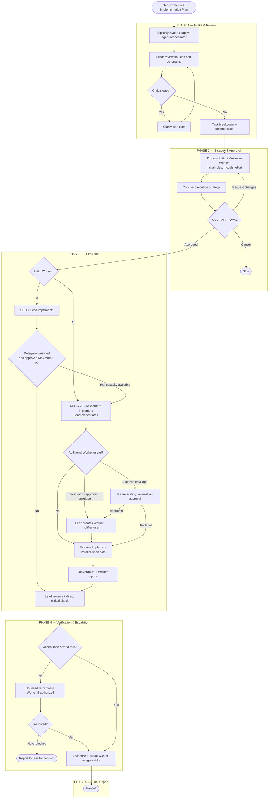
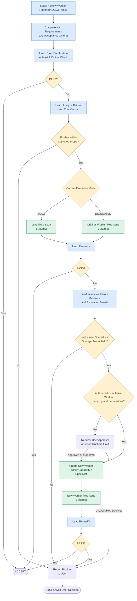

# Adaptive Agent Orchestrator Workflow

**Version 1.1 — Released** · **ภาษาไทย** · [English](ADAPTIVE_AGENT_ORCHESTRATOR_WORKFLOW_EN.md)

**Adaptive Agent Orchestrator** เป็น Skill ที่รองรับ 2 Execution Modes คือ SOLO (0 Workers) และ DELEGATED (1+ Workers) โดย Multi-Agent/Parallel เป็น Execution Style ภายใน DELEGATED ใช้งานกับ Codex, Claude Code และ Antigravity ตามความสามารถของ Runtime

Workflow เวอร์ชันใช้งานจริงแบ่งเป็น 5 Phases โดยมีหลักการสำคัญดังนี้

1. **Requirement ต้องเตรียมมาก่อน** — ผู้ใช้ใช้ Grill Me + Plan Mode จนได้ Requirement และ Implementation Plan แล้วจึงเรียก Skill
2. **เลือก SOLO หรือ Subagents ตามความเหมาะสม** — Lead วิเคราะห์ความคุ้มค่า จำนวน Worker, Role, Model และ Effort โดยไม่บังคับใช้ Multi-Agent
3. **ต้องได้รับ User Approval ก่อน Execute** — ผู้ใช้สามารถปรับ Execution Strategy และ Lead สามารถเสนอแย้งโดยให้เหตุผล
4. **Lead ตรวจสอบงานจริง** — อ่าน Report เทียบกับ Requirement และตรวจของจริงอย่างน้อย 1 Critical Check
5. **Adaptive Retry & Escalation** — แก้ไขโดยผู้ทำงานเดิม 1 รอบ หากยังไม่ผ่านให้พิจารณา Worker ใหม่ที่มีความสามารถเหมาะกว่าอีก 1 รอบ หากยังไม่ผ่านให้หยุดและรายงานผู้ใช้

กฎทั้งหมดถูกกำหนดไว้ใน Orchestration Policy ของ Skill `adaptive-agent-orchestrator` แล้ว ผู้ใช้เรียก Skill พร้อมระบุ Requirement, Plan และคำสั่งเพิ่มเติมได้ตามต้องการ

---

## 1. Full Workflow — ภาพรวมตั้งแต่เริ่มต้นจนส่งมอบงาน



*Adaptive Agent Orchestrator Workflow — Version 1.1 — Phase 4 มีรายละเอียด Retry/Escalation ในแผนภาพถัดไป*

## 2. หน้าที่ในแต่ละ Phase

| Phase | Lead Responsibilities | เงื่อนไขก่อนผ่าน Phase |
|---|---|---|
| 1. Intake & Review | ตรวจ Requirement, Plan, User Overrides, Scope และ Task Dependencies | ข้อมูลเพียงพอและไม่มี Critical Conflict |
| 2. Strategy & Approval | เลือก SOLO/Subagents, Roles, Model, Effort และเสนอ Strategy | ผู้ใช้ยืนยัน Strategy |
| 3. Execution | SOLO ลงมือเอง / Subagents สั่งงานและติดตาม | งานที่ได้รับมอบหมายส่งผลลัพธ์พร้อม Evidence |
| 4. Verification & Escalation | ตรวจ Requirement, Report และผลจริง จัดการ Retry/Escalation | ผ่าน Acceptance Criteria หรือสรุป Blocker |
| 5. Final Report | สรุปผลการทำงาน การทดสอบ ปัญหา และการตรวจรับ | ส่งมอบผลพร้อมสถานะที่ตรวจสอบได้ |

### Phase 1 — Intake & Review

Phase นี้เริ่มหลังผู้ใช้เรียก Skill โดยตรงเท่านั้น

Lead ต้องรับข้อมูลจาก Requirement File, Implementation Plan, Conversation Context และคำสั่งเพิ่มเติมของผู้ใช้ รวมถึงตรวจว่า Plan ที่เตรียมไว้ยังสอดคล้องกับ Requirement หรือไม่

หากผู้ใช้ระบุ Model, Effort หรือ Role ไว้ ให้บันทึกเป็นข้อกำหนดสำหรับการวิเคราะห์ใน Phase 2 โดยแยกระหว่าง **Preference** กับ **Hard Constraint**

กรณี Requirement ครบแล้ว Lead จะไม่เริ่ม Grill Me ใหม่ หากมีข้อสงสัยที่กระทบการทำงานจริงจึงถามเฉพาะประเด็นนั้น

### Phase 2 — Strategy & Approval

ใช้เพียง **2 Execution Modes** โดยพิจารณาประโยชน์จริง, Dependencies, Overhead และ Runtime Capability

| Workers | Mode | หน้าที่ |
|---|---|---|
| 0 | SOLO | Lead ทำ Implementation และ Verification |
| 1+ | DELEGATED | Workers ทำ Implementation; Lead ประสานงานและตรวจสอบ |

Multi-Agent (2+ Workers) และ Parallel Execution เป็น **Execution Styles ภายใน DELEGATED** ไม่ใช่ Mode แยก

Lead ประเมิน **Initial Workers** และ **Maximum Workers** โดย Maximum คือ **จำนวน Worker Instances ที่สร้างสะสมตลอด Execution** รวม Replacement, Verification และ Fresh Escalation Workers ไม่ใช่จำนวนที่ต้องสร้างให้ครบ ให้ประเมินจาก Task Breakdown, Dependencies, Specialist, ความไม่แน่นอน และ Fallback ที่คาดการณ์ได้ ใช้ **Soft Guardrail 5 Workers**; หาก Maximum > 5 ต้องอธิบายเหตุผลจาก Workstreams/ความจำเป็นจริง

**Execution Strategy ที่แสดงให้ผู้ใช้แบบกระชับ:**

| ข้อมูล | สิ่งที่แสดง |
|---|---|
| Task / Source | วัตถุประสงค์และ Requirement/Plan |
| Initial Workers | จำนวนเริ่มต้น เป็น 0 ได้ |
| Maximum Workers | จำนวนสูงสุดแบบสะสม พร้อมเหตุผล |
| Initial Worker Configuration | Role, Model, Effort ของ Initial Workers (หรือ None) |
| Execution Approach | แบ่งงาน Integration และแผนตรวจสอบโดยสรุป |
| Approval | Approve / Request Changes / Cancel |

ไม่ต้องแสดง Initial Mode, Allowed Modes, Dynamic Scaling, Maximum Concurrency หรือ Resource Budget เป็นช่องข้อมูลปกติ แต่ Lead ต้องประเมิน Scope, Permissions, Budget, Critical Checks, Retry และความเสี่ยงภายใน และแจ้งข้อจำกัดสำคัญที่มีผลต่อการตัดสินใจ

**ต้องได้รับ User Approval ก่อน Implementation** ค่า `Initial = 0, Maximum > 0` อนุญาตให้ Delegate ภายหลังภายในขอบเขตที่อนุมัติ แต่ Maximum = 0 ห้ามสร้าง Worker จนกว่าจะขออนุมัติใหม่

### Phase 3 — Execution

| หน้าที่ | SOLO | DELEGATED (1+ Workers) |
|---|---|---|
| Implementation | Lead | Workers เท่านั้น |
| Task Planning | Lead | Lead |
| Worker Creation / Scaling | ยังไม่ใช้ Worker จนกว่า Delegate ตามขอบเขตที่อนุมัติ | Lead เท่านั้น ภายใน Maximum แบบสะสม |
| Parallel | ตามเครื่องมือและความปลอดภัย | ทำพร้อมกันเมื่อแยกงานได้และคุ้มค่า |
| Critical Review | Lead | Lead ใช้ Read-only Tools ที่อนุญาต |
| First Correction | Lead (ขณะยัง SOLO) | Original Worker |

**One-way Delegation:** งานที่ Initial = 0 สามารถ SOLO → DELEGATED ได้โดยไม่ขออนุมัติใหม่ หาก Maximum > 0 และการ Delegate มีประโยชน์และยังมี Capacity เมื่อเริ่ม Delegate Implementation แล้ว Lead ห้ามกลับมาทำ Implementation อีกใน Execution เดิม แม้ไม่มี Worker ทำงานอยู่

**Dynamic Scaling:** Lead เพิ่ม Worker ภายใน Maximum แบบสะสมและ Scope, Roles, Permissions, Risks เดิมได้เอง Worker ใหม่ทุกตัว (รวม Replacement, Reviewer, Escalation) นับรวมจำนวนสะสม แต่ Worker Instance เดิมที่นำมาใช้ใหม่ไม่นับซ้ำ ต้องแจ้งผู้ใช้ Instance, Role, Model/Effort ที่ยืนยันได้ (หรือ UNVERIFIED), เหตุผล และจำนวนสะสม โดยไม่รออนุมัติอีก และต้องให้ Task Contract แก่ Worker ทุกตัว

จำนวนที่ทำงานพร้อมกันเป็นการตัดสินใจภายในตาม Runtime, Dependencies, File Ownership และ Maximum ที่อนุมัติ ไม่ต้องมีช่อง Maximum Concurrent แยก หากเกินขอบเขตต้องขออนุมัติใหม่

### Phase 4 — Verification & Adaptive Retry (รายละเอียด)

ผมแยกแผนภาพส่วนนี้ออกมา เพราะเป็นส่วนที่ควบคุมคุณภาพ เวลา และค่าใช้จ่ายของ Orchestrator โดยตรง



#### Verification Policy

Lead ต้องอ่าน Report แล้วเปรียบเทียบกับ Requirement และ Acceptance Criteria จากนั้นตรวจของจริงอย่างน้อย 1 Critical Check ที่เหมาะสมกับงาน

สำหรับ Subagent Mode ผมเสนอให้ Lead มีสิทธิ์ใช้ Read-only Inspection/Verification Tools ตามที่ Runtime อนุญาต แต่ยังคงห้าม Lead แก้ Implementation เอง หากการตรวจจำเป็นต้องเปลี่ยน State หรือใช้คำสั่งที่มีผลกระทบ ให้ส่ง Verification Worker ดำเนินการ โดย Lead ต้องรายงานให้ชัดว่าตนเองตรวจตรงส่วนใดได้จริง

สำหรับงานเสี่ยงสูง เช่น Production Deployment, Security Configuration หรือ Database Patching การตรวจเพียงข้อเดียวอาจไม่เพียงพอ ต้องตรวจ Critical Acceptance Criteria ที่เกี่ยวข้องทั้งหมดตามแผนที่อนุมัติ

#### Retry Policy

| รอบ | ผู้รับผิดชอบ | การดำเนินการ |
|---|---|---|
| Initial | Lead | ตรวจ Report และผลจริง |
| Retry 1 | Worker เดิม / Lead ใน SOLO | แก้ไขตาม Failure Evidence จำนวน 1 ครั้ง |
| Escalation | Worker ใหม่ | ใช้ Model ที่มีความสามารถสูงขึ้นหรือ Specialist ที่เหมาะสม แก้ไข 1 ครั้ง |
| Final Failure | Lead | หยุด Retry และแจ้งผู้ใช้ตัดสินใจ |

กฎ Retry ให้นับตามปัญหาหรือ Root Cause เพื่อป้องกันการเปลี่ยนชื่อ Task แล้วเริ่มนับรอบใหม่โดยไม่จำเป็น

หาก Worker ใช้ Model ระดับสูงสุดอยู่แล้ว Lead ควรพิจารณา Agent ที่มีความเชี่ยวชาญหรือแนวทางแก้ไขต่างออกไป แทนการเพิ่ม Model แบบไม่มีประโยชน์

ใน SOLO หาก Retry ไม่ผ่าน สามารถ Delegate ให้ Fresh Worker ได้ทันทีเมื่อ Maximum Workers ที่อนุมัติมากกว่า 0 และยังเหลือ Capacity ภายใน Scope/Permissions เดิม; ถ้า Maximum = 0 ต้องขออนุมัติใหม่ เมื่อ Delegate แล้ว Lead ห้ามกลับมาทำ Implementation อีก

**ข้อเสนอเพื่อควบคุมเวลา:** หากพบว่า Failure เกิดจาก Permission, Environment, Missing Input, External Service หรือข้อจำกัดของ Runtime ให้หยุด Retry ที่ไม่มีโอกาสแก้ปัญหา และรายงานผู้ใช้โดยตรง

### Phase 5 — Final Report & Handoff

เมื่อทำงานเสร็จ Lead ต้องสรุปทั้งผลของงานและหลักฐานที่ตรวจสอบได้

| หัวข้อ | ข้อมูลใน Final Report |
|---|---|
| Execution Summary | เป้าหมายและผลลัพธ์สุดท้าย |
| Execution Mode | SOLO หรือ DELEGATED ณ ตอนจบ |
| Worker Usage | Initial / Maximum / สร้างจริงสะสม และเหตุผลในการ Scaling |
| Model & Effort | Model/Effort ที่ใช้งานจริงเท่าที่ตรวจสอบได้ |
| Deliverables | Files, Code, Configuration, Documentation |
| Acceptance Criteria | Passed / Failed / Not Verified |
| Verification Evidence | สิ่งที่ Lead ตรวจเองและผลการทดสอบ |
| Retry & Escalation | ปัญหาที่พบ การแก้ไข และจำนวนครั้ง |
| Remaining Risks | ปัญหาคงเหลือและข้อจำกัด |
| Final Status | COMPLETED / PARTIAL / BLOCKED / FAILED |

หากงานไม่ผ่าน Acceptance Criteria ต้องไม่รายงานว่า Completed โดยอาศัยเพียงคำยืนยันจาก Worker

---

## 3. นโยบายหลักของ Skill

รายละเอียด Policy จริงอยู่ใน `SKILL.md` และ Reference Policies

| Policy | กฎ |
|---|---|
| Explicit Invocation | ต้องเรียก Skill อย่างชัดเจน |
| Execution Modes | SOLO (0 Workers) หรือ DELEGATED (1+); Multi-Agent เป็น Style |
| Mandatory Approval | ผู้ใช้อนุมัติ Strategy ก่อน Implementation |
| Worker Capacity | Initial + Maximum แบบสะสม; Soft Guardrail 5 Workers |
| One-way Delegation | SOLO → DELEGATED ภายในขอบเขต; Lead ห้ามกลับมา Implement |
| Dynamic Scaling | Lead เพิ่ม Worker เมื่อจำเป็นภายใน Maximum และแจ้งผู้ใช้ |
| Parallelism | Parallel เฉพาะงานอิสระและ Runtime รองรับ |
| Lead/Worker Boundary | หลัง Delegate ให้ Workers Implement และ Lead ตรวจผล |
| Model/Effort | เคารพ Hard Constraints และตรวจ Runtime จริง |
| Verification | Lead ตรวจ Critical Check โดยตรงและมี Evidence |
| Retry | ผู้ทำเดิมแก้ 1 ครั้ง และ Fresh Worker อีก 1 ครั้งเมื่อเหมาะสม |
| Risk & Permissions | งานเสี่ยงสูงต้องได้รับอนุมัติแยก |
| Final Reporting | สรุป Artifact, Worker ที่สร้างสะสม, Scaling, Evidence และความเสี่ยง |

Skill ไม่ได้สร้าง Native Subagent, Permission หรือ Model Configuration เอง หาก Runtime ไม่รองรับให้แจ้งและขอทางเลือกใหม่ ห้ามสร้าง Worker จำลองหรือให้ Lead กลับไป Implement หลัง Delegate

## 4. ตัวอย่างการเรียกใช้งาน Skill

หลังจากติดตั้ง Skill แล้ว ให้ระบุ Requirement หรือ Implementation Plan ของงานที่เตรียมไว้ โดยไม่ต้องใส่ Orchestration Policy ซ้ำใน Prompt

### Standard Prompt Template

```text
/adaptive-agent-orchestrator

Execute based on: <requirements.md or implementation-plan.md>

<Optional Overrides>
Model Preference: <optional model and effort preference>
Additional Instructions: <optional task-specific instructions>
```

ส่วน **Optional Overrides** ไม่จำเป็นต้องระบุ หากไม่มีคำสั่งเพิ่มเติม สามารถตัดออกทั้งหมดได้ โดย Requirement และ Plan ของแต่ละงานยังคงอยู่ภายนอก Skill

### Example 1 — Standard Execution (No Override)

```text
/adaptive-agent-orchestrator

Execute based on: implementation-plan.md
```

Lead จะตรวจ Requirement/Plan, วิเคราะห์ Task Breakdown และ Dependencies, เลือก SOLO หรือ Subagents ตามความเหมาะสม แล้วเสนอ Execution Strategy เพื่อรอการอนุมัติ

### Example 2 — Execution with Overrides

```text
/adaptive-agent-orchestrator

Execute based on:
- requirements.md
- implementation-plan.md

Model Preference: Prefer Luna with Max Effort.

Additional Instructions:
- Prioritize security verification.
- Do not deploy to production.
```

`Prefer Luna with Max Effort` เป็น **Preference** ไม่ใช่ข้อบังคับให้ใช้ Model นี้เท่านั้น Lead จึงเสนอทางเลือกที่เหมาะสมกว่าได้พร้อมเหตุผลและต้องตรวจความพร้อมใช้งานของ Runtime ส่วน `Do not deploy to production` เป็น **ข้อห้ามที่ต้องปฏิบัติตาม** และให้ความสำคัญกับ Security Verification ตามคำสั่ง

**การเรียกใช้บนแพลตฟอร์ม:** ตัวอย่างใช้ `/adaptive-agent-orchestrator` สำหรับ Claude Code และ Antigravity ที่รองรับ ส่วน **Codex ใช้ `$adaptive-agent-orchestrator`** แทน

**Mandatory Approval:** คำว่า `Execute based on` เริ่มกระบวนการวิเคราะห์ Strategy ไม่ใช่คำสั่งข้ามขั้นตอนอนุมัติ Lead ต้องแสดง Execution Strategy แล้วรอผู้ใช้ยืนยันก่อนเริ่ม Implementation หรือ Spawn Execution Workers

Skill จะดำเนินงานตาม Workflow ทั้ง 5 Phases ภายใต้ Execution Strategy ที่ได้รับอนุมัติและ Permission ของ Runtime
