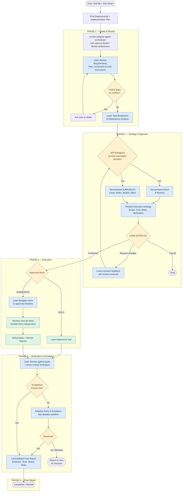
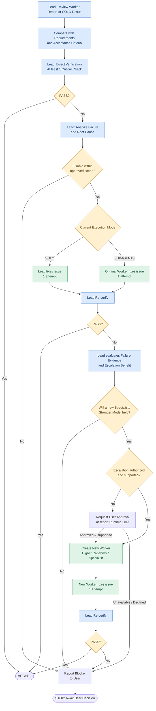

# Adaptive Agent Orchestrator Workflow

**Version 1.0 — Released**

**Adaptive Agent Orchestrator** เป็น Skill ที่ใช้งานจริงสำหรับเลือกและควบคุมการทำงานแบบ SOLO, DELEGATED และ MULTI-AGENT โดยรองรับ Codex, Claude Code และ Antigravity ตามความสามารถของแต่ละแพลตฟอร์ม

Workflow เวอร์ชันใช้งานจริงแบ่งเป็น 5 Phases โดยมีหลักการสำคัญดังนี้

1. **Requirement ต้องเตรียมมาก่อน** — ผู้ใช้ใช้ Grill Me + Plan Mode จนได้ Requirement และ Implementation Plan แล้วจึงเรียก Skill
2. **เลือก SOLO หรือ Subagents ตามความเหมาะสม** — Lead วิเคราะห์ความคุ้มค่า จำนวน Worker, Role, Model และ Effort โดยไม่บังคับใช้ Multi-Agent
3. **ต้องได้รับ User Approval ก่อน Execute** — ผู้ใช้สามารถปรับ Execution Strategy และ Lead สามารถเสนอแย้งโดยให้เหตุผล
4. **Lead ตรวจสอบงานจริง** — อ่าน Report เทียบกับ Requirement และตรวจของจริงอย่างน้อย 1 Critical Check
5. **Adaptive Retry & Escalation** — แก้ไขโดยผู้ทำงานเดิม 1 รอบ หากยังไม่ผ่านให้พิจารณา Worker ใหม่ที่มีความสามารถเหมาะกว่าอีก 1 รอบ หากยังไม่ผ่านให้หยุดและรายงานผู้ใช้

กฎทั้งหมดถูกกำหนดไว้ใน Orchestration Policy ของ Skill `adaptive-agent-orchestrator` แล้ว ผู้ใช้เรียก Skill พร้อมระบุ Requirement, Plan และคำสั่งเพิ่มเติมได้ตามต้องการ

---

## 1. Full Workflow — ภาพรวมตั้งแต่เริ่มต้นจนส่งมอบงาน



*Adaptive Agent Orchestrator Workflow — Version 1.0 — Phase 4 มีรายละเอียดการ Retry/Escalation ในแผนภาพถัดไป*

## 2. หน้าที่ในแต่ละ Phase

| Phase | Lead Responsibilities | เงื่อนไขก่อนผ่าน Phase |
|---|---|---|
| 1. Intake & Review | ตรวจ Requirement, Plan, User Overrides, Scope และ Task Dependencies | ข้อมูลเพียงพอและไม่มี Critical Conflict |
| 2. Strategy & Approval | เลือก SOLO/Subagents, Roles, Model, Effort และเสนอ Strategy | ผู้ใช้ยืนยัน Strategy |
| 3. Execution | SOLO ลงมือเอง / Subagents สั่งงานและติดตาม | งานที่ได้รับมอบหมายส่งผลลัพธ์พร้อม Evidence |
| 4. Verification & Escalation | ตรวจ Requirement, Report และผลจริง จัดการ Retry/Escalation | ผ่าน Acceptance Criteria หรือสรุป Blocker |
| 5. Final Report | สรุปผลการทำงาน การทดสอบ ปัญหา และการตรวจรับ | ส่งมอบผลพร้อมสถานะที่ตรวจสอบได้ |

### Phase 1 — Intake & Review

Phase นี้เริ่มหลังผู้ใช้เรียก Skill โดยตรงเท่านั้น

Lead ต้องรับข้อมูลจาก Requirement File, Implementation Plan, Conversation Context และคำสั่งเพิ่มเติมของผู้ใช้ รวมถึงตรวจว่า Plan ที่เตรียมไว้ยังสอดคล้องกับ Requirement หรือไม่

หากผู้ใช้ระบุ Model, Effort หรือ Role ไว้ ให้บันทึกเป็นข้อกำหนดสำหรับการวิเคราะห์ใน Phase 2 โดยแยกระหว่าง **Preference** กับ **Hard Constraint**

กรณี Requirement ครบแล้ว Lead จะไม่เริ่ม Grill Me ใหม่ หากมีข้อสงสัยที่กระทบการทำงานจริงจึงถามเฉพาะประเด็นนั้น

### Phase 2 — Strategy & Approval

Lead ต้องประเมินว่าการใช้ Subagent ช่วยเพิ่มคุณภาพ ลดเวลา ลดภาระ Context หรือเพิ่มประโยชน์จากการตรวจสอบอย่างอิสระได้หรือไม่ โดยพิจารณา Overhead และค่าใช้จ่ายประกอบ

**Execution Modes ที่รองรับ**

| Workers | Mode | หน้าที่ |
|---|---|---|
| 0 | SOLO | Lead ทำเอง |
| 1 | DELEGATED | Lead + Worker |
| 2+ | MULTI-AGENT | Parallel / Specialist |

จำนวน Worker ให้เลือกจากความจำเป็นจริง โดยคำนึงถึง Dependency, Context, Model Cost และ Coordination Overhead

เมื่อได้ Execution Strategy แล้ว ต้องแสดงข้อมูลให้ผู้ใช้ Review ก่อนเริ่ม Implementation โดยข้อมูลที่เสนอควรมีดังนี้

| ข้อมูล | สิ่งที่ต้องแสดง |
|---|---|
| Execution Mode | SOLO / DELEGATED / MULTI-AGENT พร้อมเหตุผล |
| Worker Configuration | จำนวน, Role, Model, Effort และหน้าที่ |
| Task Assignment | งานที่แต่ละ Worker รับผิดชอบ |
| Dependencies | งานใดต้องรอ งานใด Parallel ได้ |
| Scope & Permissions | สิทธิ์และขอบเขตไฟล์หรือระบบ |
| Verification Plan | Acceptance Criteria และ Critical Checks |
| Resource Limits | Worker สูงสุด, Retry, Budget และข้อจำกัด Runtime |
| Escalation Policy | Worker/Model สำรองที่อนุญาตเมื่อแก้งานไม่สำเร็จ |

**User Approval เป็น Mandatory Gate** แม้ผู้ใช้จะเรียก Skill พร้อมคำสั่งว่า `start implementation` แล้วก็ตาม

หลังอนุมัติ Lead สามารถปรับจำนวน Worker ภายในขอบเขตที่อนุมัติไว้ได้ หากต้องเพิ่มสิทธิ์ เปลี่ยน Scope หรือใช้ Resource เกินขอบเขต ต้องขออนุมัติใหม่

### Phase 3 — Execution

| | SOLO | DELEGATED / MULTI-AGENT |
|---|---|---|
| Implementation | Lead ทำเอง | Worker ทำ |
| Task Planning | Lead | Lead |
| Worker Creation | ไม่มี | Lead เท่านั้น |
| Scope Changes | ต้องอยู่ในแผนที่อนุมัติ | Lead ตัดสินใจภายในแผน |
| Parallel Execution | ตามเครื่องมือที่มี | ใช้ Worker หลายตัวเมื่อเหมาะสม |
| Review | Lead | Lead |
| Correction | Lead แก้เองในรอบแรก | ส่ง Worker เดิมแก้ |

ในโหมด Subagents ต้องมี Task Contract ระบุ Input, Scope, Allowed Files, Expected Output และ Acceptance Criteria แยกแต่ละ Task

Worker สามารถใช้ Technical Reasoning ในการแก้ปัญหาได้ แต่ห้ามเปลี่ยน Architecture, ขยาย Requirement หรือ Spawn Agent เพิ่มเอง

Lead ต้องรักษา File Ownership ให้ชัดเจนเพื่อป้องกัน Worker หลายตัวแก้ไฟล์เดียวกันพร้อมกัน หากจำเป็นต้องแก้ไฟล์ร่วมกันให้กำหนด Integration Owner หรือวิธี Merge ที่ชัดเจน

### Phase 4 — Verification & Adaptive Retry (รายละเอียด)

ผมแยกแผนภาพส่วนนี้ออกมา เพราะเป็นส่วนที่ควบคุมคุณภาพ เวลา และค่าใช้จ่ายของ Orchestrator โดยตรง



#### Verification Policy

Lead ต้องอ่าน Report แล้วเปรียบเทียบกับ Requirement และ Acceptance Criteria จากนั้นตรวจของจริงอย่างน้อย 1 Critical Check ที่เหมาะสมกับงาน

สำหรับ Subagent Mode ผมเสนอให้ Lead มีสิทธิ์ใช้ Read-only Inspection/Verification Tools ตามที่ Runtime อนุญาต แต่ยังคงห้าม Lead แก้ Implementation เอง หากการตรวจจำเป็นต้องเปลี่ยน State หรือใช้คำสั่งที่มีผลกระทบ ให้ส่ง Verification Worker ดำเนินการ โดย Lead ต้องรายงานให้ชัดว่าตนเองตรวจตรงส่วนใดได้จริง

สำหรับงานเสี่ยงสูง เช่น Production Deployment, Security Configuration หรือ Database Patching การตรวจเพียงข้อเดียวอาจไม่เพียงพอ ต้องตรวจ Critical Acceptance Criteria ที่เกี่ยวข้องทั้งหมดตามแผนที่อนุมัติ

#### Retry Policy

| รอบ | ผู้รับผิดชอบ | การดำเนินการ |
|---|---|---|
| Initial | Lead | ตรวจ Report และผลจริง |
| Retry 1 | Worker เดิม / Lead ใน SOLO | แก้ไขตาม Failure Evidence จำนวน 1 ครั้ง |
| Escalation | Worker ใหม่ | ใช้ Model ที่มีความสามารถสูงขึ้นหรือ Specialist ที่เหมาะสม แก้ไข 1 ครั้ง |
| Final Failure | Lead | หยุด Retry และแจ้งผู้ใช้ตัดสินใจ |

กฎ Retry ให้นับตามปัญหาหรือ Root Cause เพื่อป้องกันการเปลี่ยนชื่อ Task แล้วเริ่มนับรอบใหม่โดยไม่จำเป็น

หาก Worker ใช้ Model ระดับสูงสุดอยู่แล้ว Lead ควรพิจารณา Agent ที่มีความเชี่ยวชาญหรือแนวทางแก้ไขต่างออกไป แทนการเพิ่ม Model แบบไม่มีประโยชน์

ใน SOLO Mode ถ้าจำเป็นต้องเปลี่ยนไปใช้ Subagent หลังแก้เองไม่ผ่าน ต้องตรวจว่าผู้ใช้อนุมัติ Fallback นี้ไว้ใน Execution Strategy หรือไม่ หากยังไม่อนุมัติ ต้องขออนุมัติก่อนสร้าง Worker

**ข้อเสนอเพื่อควบคุมเวลา:** หากพบว่า Failure เกิดจาก Permission, Environment, Missing Input, External Service หรือข้อจำกัดของ Runtime ให้หยุด Retry ที่ไม่มีโอกาสแก้ปัญหา และรายงานผู้ใช้โดยตรง

### Phase 5 — Final Report & Handoff

เมื่อทำงานเสร็จ Lead ต้องสรุปทั้งผลของงานและหลักฐานที่ตรวจสอบได้

| หัวข้อ | ข้อมูลใน Final Report |
|---|---|
| Execution Summary | เป้าหมายและผลลัพธ์สุดท้าย |
| Execution Mode | SOLO หรือ Subagents พร้อม Worker ที่ใช้จริง |
| Model & Effort | Model/Effort ที่ใช้งานจริงเท่าที่ตรวจสอบได้ |
| Deliverables | Files, Code, Configuration, Documentation |
| Acceptance Criteria | Passed / Failed / Not Verified |
| Verification Evidence | สิ่งที่ Lead ตรวจเองและผลการทดสอบ |
| Retry & Escalation | ปัญหาที่พบ การแก้ไข และจำนวนครั้ง |
| Remaining Risks | ปัญหาคงเหลือและข้อจำกัด |
| Final Status | COMPLETED / PARTIAL / BLOCKED / FAILED |

หากงานไม่ผ่าน Acceptance Criteria ต้องไม่รายงานว่า Completed โดยอาศัยเพียงคำยืนยันจาก Worker

---

## 3. นโยบายหลักของ Skill

ตารางนี้สรุปกฎการทำงานที่กำหนดไว้ใน `SKILL.md` และ Reference Policies ของ Skill

| Policy | กฎ |
|---|---|
| Explicit Invocation | เริ่ม Skill เมื่อผู้ใช้เรียกใช้งาน |
| Requirement Reuse | ใช้ Requirement/Plan ที่มีอยู่ ไม่ถามซ้ำโดยไม่จำเป็น |
| Adaptive Execution | เลือก SOLO หรือ Subagents จากประโยชน์ที่ได้รับ |
| Model Selection | ใช้ User Preference เป็นค่าเริ่มต้น ปรับได้พร้อมเหตุผล |
| Mandatory Approval | ต้องอนุมัติ Execution Strategy ก่อนเริ่มงาน |
| Lead Responsibilities | วางแผนและ Review; ทำ Implementation ได้เฉพาะ SOLO |
| Dynamic Workers | เพิ่ม Worker ภายในขอบเขตที่ผู้ใช้อนุมัติ |
| Parallel Execution | Parallel เฉพาะงานที่เป็นอิสระและเหมาะสม |
| Worker Isolation | Worker ทำตาม Scope ห้ามขยายงานหรือ Delegate เอง |
| Lead Verification | ตรวจ Report และของจริงอย่างน้อย 1 Critical Check |
| Adaptive Retry | ผู้ทำเดิมแก้ 1 รอบ และ Escalate ได้อีก 1 รอบเมื่อเหมาะสม |
| Failure Stop | หยุดเมื่อเกิน Retry Limit หรือพบ Blocker ที่แก้เองไม่ได้ |
| Safety & Permissions | ต้องปฏิบัติตาม Permission ของ Runtime และขออนุมัติงานเสี่ยงสูงแยกต่างหาก |
| Evidence-Based Reporting | รายงานผลตามหลักฐานจริง ไม่อ้างผลทดสอบที่ไม่ได้ทำ |

**เรื่องที่สำคัญ:** Skill นี้จะเป็นตัวกำหนดพฤติกรรมและ Workflow กลาง ส่วนสิทธิ์ของ Lead/Worker, การสร้าง Subagent จริง และ Model/Effort ที่เลือกได้ยังขึ้นกับ Codex, Claude Code หรือ Antigravity หาก Runtime ไม่รองรับเงื่อนไขที่จำเป็น Lead ต้องแจ้งข้อจำกัดและเสนอทางเลือกให้ผู้ใช้อนุมัติ ห้ามเปลี่ยน Execution Mode เงียบ ๆ

## 4. ตัวอย่างการเรียกใช้งาน Skill

หลังจากติดตั้ง Skill ผู้ใช้สามารถเรียกใช้งานตามตัวอย่างสำหรับ Claude Code หรือ Antigravity ส่วน Codex ใช้ `$adaptive-agent-orchestrator`

**Example Invocation**

```text
/adaptive-agent-orchestrator

Requirements: requirements.md
Implementation Plan: implementation-plan.md

Model Preference: Luna, Max Effort

เริ่มวิเคราะห์ Execution Strategy
และเสนอให้ Review ก่อนลงมือทำ
```

Skill จะดำเนินงานตาม 5 Phases โดยอัตโนมัติภายใต้ Approval และ Permission ที่กำหนด ผู้ใช้ไม่ต้องใส่ Orchestration Policy ซ้ำใน Prompt
