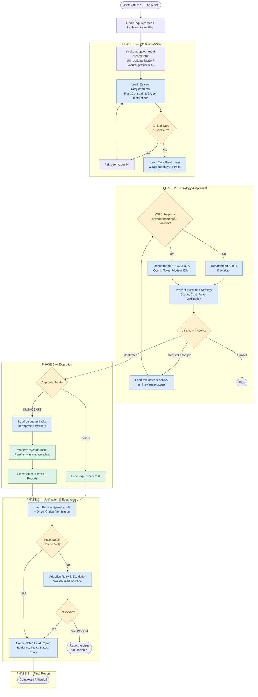
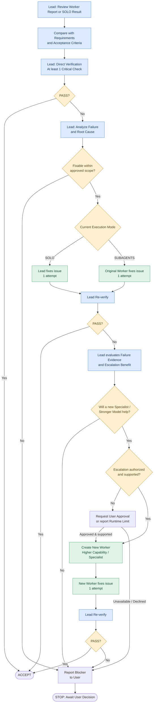

# Adaptive Agent Orchestrator Workflow

**Version 1.0 — Released** · **English** · [ภาษาไทย](ADAPTIVE_AGENT_ORCHESTRATOR_WORKFLOW.md)

**Adaptive Agent Orchestrator** is a reusable Skill that selects and coordinates SOLO, DELEGATED, and MULTI-AGENT execution. It supports Codex, Claude Code, and Antigravity subject to each platform's actual capabilities.

The production workflow has five phases and follows these principles:

1. **Prepare requirements first.** The user completes requirement discovery (for example, Grill Me + Plan Mode) and an implementation plan before invoking the Skill.
2. **Select SOLO or Subagents as appropriate.** The Lead evaluates the benefits and overhead, number of Workers, roles, models, and effort settings. Multi-Agent execution is never mandatory by default.
3. **Require user approval before execution.** The user can request changes to the strategy; the Lead should evaluate those changes and explain any objections.
4. **Verify real outcomes.** The Lead reads the Worker reports, compares deliverables with requirements and acceptance criteria, and performs at least one direct critical check.
5. **Use bounded retries and escalation.** The original executor gets one correction attempt. If that fails, the Lead may assign one correction attempt to a new, better-suited Worker. If the problem remains unresolved, stop and ask the user to decide.

These rules are already defined in the `adaptive-agent-orchestrator` Skill's orchestration policy. Users only need to provide their requirements, plan, and any task-specific preferences.

---

## 1. Full Workflow — From Requirements to Handoff



*Adaptive Agent Orchestrator Workflow — Version 1.0. Phase 4 is expanded in the second diagram below.*

## 2. Responsibilities and Exit Conditions by Phase

| Phase | Lead responsibilities | Exit condition |
|---|---|---|
| 1. Intake & Review | Review requirements, plan, user overrides, scope, and task dependencies | Information is sufficient and there are no critical conflicts |
| 2. Strategy & Approval | Select SOLO/Subagents, roles, models, effort, and propose the strategy | User explicitly approves the execution strategy |
| 3. Execution | Implement in SOLO or delegate and coordinate in Subagent modes | Assigned tasks return deliverables with evidence |
| 4. Verification & Escalation | Compare requirements, reports, and actual results; manage retries and escalation | Acceptance criteria pass or a blocker is documented |
| 5. Final Report | Summarize results, tests, issues, and acceptance status | Deliver a verifiable status report and handoff |

### Phase 1 — Intake & Review

This phase starts only when the user explicitly invokes the Skill.

The Lead takes input from the requirements file, implementation plan, relevant conversation context, and any additional user instructions. It verifies that the implementation plan remains consistent with the requirements.

If the user has specified a model, reasoning effort, or Worker roles, the Lead records these for Phase 2 and distinguishes **preferences** from **hard constraints**.

When the requirements are already complete, the Lead must not restart Grill Me or re-interview the user. It asks targeted questions only when a material ambiguity could affect execution.

### Phase 2 — Strategy & Approval

The Lead evaluates whether Subagents would improve quality, reduce execution time or context pressure, or provide useful independent verification. It also considers the coordination overhead and costs.

**Supported execution modes**

| Workers | Mode | Execution responsibility |
|---|---|---|
| 0 | SOLO | Lead executes the work directly |
| 1 | DELEGATED | Lead orchestrates and reviews; one Worker executes |
| 2+ | MULTI-AGENT | Specialized Workers execute, potentially in parallel |

The number of Workers must reflect actual needs, including dependencies, context requirements, model costs, and coordination overhead.

Before implementation, the Lead presents an Execution Strategy for user review with the following information:

| Item | Required information |
|---|---|
| Execution Mode | SOLO / DELEGATED / MULTI-AGENT, with justification |
| Worker Configuration | Count, roles, models, effort, and responsibilities |
| Task Assignment | The work assigned to each Worker |
| Dependencies | Tasks that must wait and tasks that can run in parallel |
| Scope & Permissions | Allowed operations, files, and systems |
| Verification Plan | Acceptance criteria and critical checks |
| Resource Limits | Maximum Workers, retries, budget, and runtime limitations |
| Escalation Policy | Authorized fallback Worker/model when correction fails |

**User approval is a mandatory gate**, even when the user invoked the Skill with `start implementation`.

After approval, the Lead may adjust Worker count only within the approved limits. Any new permissions, scope changes, or resource requirements beyond those limits require renewed approval.

### Phase 3 — Execution

| Responsibility | SOLO | DELEGATED / MULTI-AGENT |
|---|---|---|
| Implementation | Lead | Worker |
| Task Planning | Lead | Lead |
| Worker Creation | None | Lead only |
| Scope Changes | Must remain within the approved plan | Lead decides within the approved plan |
| Parallel Execution | As supported by the available tools | Use multiple Workers when justified |
| Review | Lead | Lead |
| Correction | Lead performs the first correction | Original Worker performs the first correction |

In Subagent modes, every delegated task must include a **Task Contract** specifying inputs, scope, allowed files, expected outputs, and acceptance criteria.

Workers may apply technical reasoning to complete their assigned tasks. They must not independently change the architecture, extend requirements, or spawn additional agents.

The Lead must maintain clear file ownership to prevent conflicting concurrent edits. If Workers need to touch shared files, appoint an integration owner or define an explicit merge process.

### Phase 4 — Verification & Adaptive Retry (Detailed)

This part of the workflow controls the quality, duration, and cost of execution.



#### Verification Policy

The Lead reads the execution report, checks it against the requirements and acceptance criteria, and **directly verifies at least one meaningful critical condition** on a real deliverable or system.

In Subagent modes, the Lead may use read-only inspection or verification tools where the runtime permits, but must not repair the implementation directly. If verification requires changing state or running potentially impactful commands, delegate it to an authorized Verification Worker. The Lead must clearly distinguish checks it performed directly from those reported by Workers.

For high-risk work such as production deployments, security configurations, or database patching, a single critical check may be insufficient. Verify all applicable critical acceptance criteria required by the approved plan.

#### Retry Policy

| Stage | Owner | Action |
|---|---|---|
| Initial | Lead | Review the report and actual outcome |
| Retry 1 | Original Worker / Lead in SOLO | Perform one correction using the failure evidence |
| Escalation | Fresh Worker | Perform one correction using a more capable model or better-suited specialist |
| Final Failure | Lead | Stop retrying and ask the user to decide |

Count retries by the underlying issue or root cause to prevent resetting the counter simply by renaming a task.

If the original Worker already uses the strongest available model, the Lead should consider a new specialist or a genuinely different solution approach rather than an unjustified model upgrade.

In SOLO mode, if the first correction fails and switching to a Subagent is needed, confirm that the user authorized this fallback in the Execution Strategy. If not, obtain approval before creating the Worker.

**Time-control rule:** If the failure is caused by permissions, environment constraints, missing inputs, external services, or runtime limitations, stop retries that cannot reasonably resolve the blocker and report it directly to the user.

### Phase 5 — Final Report & Handoff

Once execution ends, the Lead summarizes both the deliverables and the verifiable evidence.

| Section | Required content |
|---|---|
| Execution Summary | Objective and final outcome |
| Execution Mode | SOLO or Subagents, including Workers actually used |
| Model & Effort | Actual model/effort settings to the extent verifiable |
| Deliverables | Files, code, configurations, and documentation |
| Acceptance Criteria | Passed / Failed / Not Verified |
| Verification Evidence | Checks performed directly by the Lead and actual test results |
| Retry & Escalation | Observed failures, corrections, and attempt counts |
| Remaining Risks | Open issues and limitations |
| Final Status | COMPLETED / PARTIAL / BLOCKED / FAILED |

If acceptance criteria are not met, the Lead must not report the task as Completed solely because a Worker claims success.

---

## 3. Core Skill Policies

The following policies are defined in `SKILL.md` and the Skill's reference documents.

| Policy | Rule |
|---|---|
| Explicit Invocation | Start the Skill when the user explicitly invokes it |
| Requirement Reuse | Reuse available requirements and plans; avoid unnecessary repeated questions |
| Adaptive Execution | Choose SOLO or Subagents based on actual benefits |
| Model Selection | Treat user preferences as starting points; justify proposed alternatives |
| Mandatory Approval | Require approval of the Execution Strategy before implementation |
| Lead Responsibilities | Plan and review; implement only in SOLO |
| Dynamic Workers | Adjust Worker allocation within the user's approved bounds |
| Parallel Execution | Parallelize independent, suitable tasks |
| Worker Isolation | Workers stay within scope and do not delegate or extend tasks independently |
| Lead Verification | Read reports and directly verify at least one meaningful critical condition |
| Adaptive Retry | One original-executor correction; optionally one fresh-worker correction |
| Failure Stop | Stop after retry limits or when an unresolvable blocker is identified |
| Safety & Permissions | Obey runtime permissions; seek separate approval for high-risk actions |
| Evidence-Based Reporting | Report actual evidence and never invent tests or outcomes |

**Important:** The Skill specifies behavioral rules and a common workflow. Lead/Worker permissions, actual Subagent spawning, and model/effort selection depend on Codex, Claude Code, or Antigravity. If the runtime cannot support a required capability, the Lead must explain the limitation and request approval for an alternative. It must not silently switch execution modes.

## 4. Example Skill Invocation

After installing the Skill, invoke it with your requirements and implementation plan. The following example is for Claude Code or Antigravity where the slash command is supported. For Codex, use `$adaptive-agent-orchestrator`.

**Example Invocation**

```text
/adaptive-agent-orchestrator

Requirements: requirements.md
Implementation Plan: implementation-plan.md

Model Preference: Luna, Max Effort

Analyze the Execution Strategy and present it for my review
before starting implementation.
```

The Skill then follows all five phases subject to the approved strategy and available permissions. Users do not need to repeat the orchestration policy in their invocation prompt.
