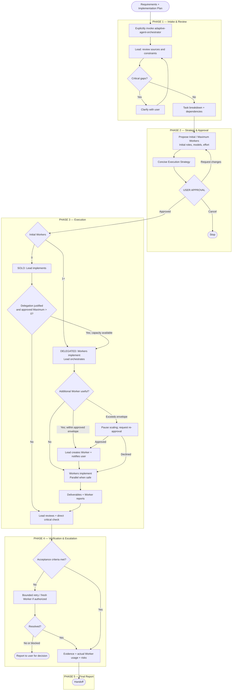
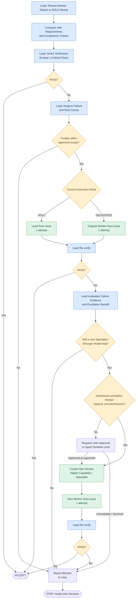

# Adaptive Agent Orchestrator Workflow

**Version 1.1 — Released** · **English** · [ภาษาไทย](ADAPTIVE_AGENT_ORCHESTRATOR_WORKFLOW.md)

**Adaptive Agent Orchestrator** uses two execution modes: SOLO (0 Workers) and DELEGATED (1+ Workers). Multi-agent and parallel work are styles within DELEGATED. It supports Codex, Claude Code and Antigravity subject to real runtime capabilities.

The production workflow has five phases and follows these principles:

1. **Prepare requirements first.** The user completes requirement discovery (for example, Grill Me + Plan Mode) and an implementation plan before invoking the Skill.
2. **Select SOLO or Subagents as appropriate.** The Lead evaluates the benefits and overhead, number of Workers, roles, models, and effort settings. Multi-Agent execution is never mandatory by default.
3. **Require user approval before execution.** The user can request changes to the strategy; the Lead should evaluate those changes and explain any objections.
4. **Verify real outcomes.** The Lead reads the Worker reports, compares deliverables with requirements and acceptance criteria, and performs at least one direct critical check.
5. **Use bounded retries and escalation.** The original executor gets one correction attempt. If that fails, the Lead may assign one correction attempt to a new, better-suited Worker. If the problem remains unresolved, stop and ask the user to decide.

These rules are already defined in the `adaptive-agent-orchestrator` Skill's orchestration policy. Users only need to provide their requirements, plan, and any task-specific preferences.

---

## 1. Full Workflow — From Requirements to Handoff



*Adaptive Agent Orchestrator Workflow — Version 1.1. Phase 4 is expanded in the next diagram.*

## 2. Responsibilities and Exit Conditions by Phase

| Phase | Lead responsibilities | Exit condition |
|---|---|---|
| 1. Intake & Review | Review requirements, plan, user overrides, scope, and task dependencies | Information is sufficient and there are no critical conflicts |
| 2. Strategy & Approval | Select SOLO/Subagents, roles, models, effort, and propose the strategy | User explicitly approves the execution strategy |
| 3. Execution | Implement in SOLO or delegate and coordinate in Subagent modes | Assigned tasks return deliverables with evidence |
| 4. Verification & Escalation | Compare requirements, reports, and actual results; manage retries and escalation | Acceptance criteria pass or a blocker is documented |
| 5. Final Report | Summarize results, tests, issues, and acceptance status | Deliver a verifiable status report and handoff |

### Phase 1 — Intake & Review

This phase starts only when the user explicitly invokes the Skill.

The Lead takes input from the requirements file, implementation plan, relevant conversation context, and any additional user instructions. It verifies that the implementation plan remains consistent with the requirements.

If the user has specified a model, reasoning effort, or Worker roles, the Lead records these for Phase 2 and distinguishes **preferences** from **hard constraints**.

When the requirements are already complete, the Lead must not restart Grill Me or re-interview the user. It asks targeted questions only when a material ambiguity could affect execution.

### Phase 2 — Strategy & Approval

Use two execution modes, based on real value, dependencies, coordination overhead and runtime capability:

| Workers | Mode | Responsibility |
|---|---|---|
| 0 | SOLO | Lead implements and verifies |
| 1+ | DELEGATED | Workers implement; Lead orchestrates and verifies |

Multi-Agent (2+ Workers) and parallel execution are **styles of DELEGATED**, not separate modes.

The Lead calculates **Initial Workers** and **Maximum Workers**. Maximum is the **cumulative number of distinct Worker instances created during the execution**, including replacements, verification and fresh escalation Workers, not a target to fill. Base it on tasks, dependencies, specialization, uncertainty and credible fallback needs. Use a **soft guardrail of five Workers**: a proposed Maximum > 5 requires a specific explanation of the planned workstreams/contingencies.

**Concise user-facing Execution Strategy Proposal:**

| Field | Show |
|---|---|
| Task / Source | Objective and requirements/plan |
| Initial Workers | Starting number, may be 0 |
| Maximum Workers | Cumulative cap and short justification |
| Initial Worker Configuration | Role, model, effort for each initial Worker (or None) |
| Execution Approach | Brief division of work, integration and Lead verification |
| Approval | Approve / Request Changes / Cancel |

Do **not** show routine separate fields for Initial Mode, Allowed Modes, Dynamic Scaling, Maximum Concurrency or generic Resource Budget. The Lead still evaluates these operational safeguards, risk, permission boundaries, budgets, critical checks and retry ceilings internally. Disclose material limitations or high-risk operations that affect informed approval.

**User approval is mandatory before implementation.** An approved `Initial = 0, Maximum > 0` preauthorizes later one-way delegation. Maximum = 0 prohibits Worker creation without revised approval.

### Phase 3 — Execution

| Responsibility | SOLO | DELEGATED (1+ Workers) |
|---|---|---|
| Implementation | Lead | Workers only |
| Task planning | Lead | Lead |
| Worker creation/scaling | None until justified, approved one-way delegation | Lead only, within cumulative Maximum |
| Parallel work | When safe and available | For independent tasks when justified |
| Critical review | Lead | Lead with authorized read-only tools |
| First correction | Lead (while SOLO) | Original Worker |

**One-way transition:** Initial = 0 can move SOLO → DELEGATED without another approval if Maximum > 0, capacity remains and delegation adds value. Once a Worker is delegated implementation, Lead must not implement again during the same execution, even with zero active Workers.

**Dynamic scaling:** Lead can add a Worker inside approved cumulative Maximum and unchanged permissions, roles, scope and risk. Every new instance (including replacement/fresh reviewer/escalation) consumes a slot; reusing the same instance does not. Notify the user of new instance, role, requested/verified model and effort (or UNVERIFIED), reason and cumulative count, without pausing for approval. Each Worker receives an explicit Task Contract.

Concurrency is a safe internal scheduling choice limited by the runtime, shared-file ownership and cumulative ceiling, not a separate approval field. Changes beyond the envelope require explicit renewed approval.

### Phase 4 — Verification & Adaptive Retry (Detailed)

This part of the workflow controls the quality, duration, and cost of execution.



#### Verification Policy

The Lead reads the execution report, checks it against the requirements and acceptance criteria, and **directly verifies at least one meaningful critical condition** on a real deliverable or system.

In Subagent modes, the Lead may use read-only inspection or verification tools where the runtime permits, but must not repair the implementation directly. If verification requires changing state or running potentially impactful commands, delegate it to an authorized Verification Worker. The Lead must clearly distinguish checks it performed directly from those reported by Workers.

For high-risk work such as production deployments, security configurations, or database patching, a single critical check may be insufficient. Verify all applicable critical acceptance criteria required by the approved plan.

#### Retry Policy

| Stage | Owner | Action |
|---|---|---|
| Initial | Lead | Review the report and actual outcome |
| Retry 1 | Original Worker / Lead in SOLO | Perform one correction using the failure evidence |
| Escalation | Fresh Worker | Perform one correction using a more capable model or better-suited specialist |
| Final Failure | Lead | Stop retrying and ask the user to decide |

Count retries by the underlying issue or root cause to prevent resetting the counter simply by renaming a task.

If the original Worker already uses the strongest available model, the Lead should consider a new specialist or a genuinely different solution approach rather than an unjustified model upgrade.

In SOLO, a positive approved Maximum already authorizes a useful fallback to a fresh Worker within the same scope and limits; with Maximum = 0, request revised approval first. Once delegated, Lead must not resume implementation.

**Time-control rule:** If the failure is caused by permissions, environment constraints, missing inputs, external services, or runtime limitations, stop retries that cannot reasonably resolve the blocker and report it directly to the user.

### Phase 5 — Final Report & Handoff

Once execution ends, the Lead summarizes both the deliverables and the verifiable evidence.

| Section | Required content |
|---|---|
| Execution Summary | Objective and final outcome |
| Execution Mode | Final SOLO or DELEGATED |
| Worker Usage | Initial / Maximum / actual cumulative instances, scaling reasons |
| Model & Effort | Actual model/effort settings to the extent verifiable |
| Deliverables | Files, code, configurations, and documentation |
| Acceptance Criteria | Passed / Failed / Not Verified |
| Verification Evidence | Checks performed directly by the Lead and actual test results |
| Retry & Escalation | Observed failures, corrections, and attempt counts |
| Remaining Risks | Open issues and limitations |
| Final Status | COMPLETED / PARTIAL / BLOCKED / FAILED |

If acceptance criteria are not met, the Lead must not report the task as Completed solely because a Worker claims success.

---

## 3. Core Skill Policies

The authoritative rules are in `SKILL.md` and its policy references.

| Policy | Rule |
|---|---|
| Explicit Invocation | User explicitly invokes the Skill |
| Execution Modes | SOLO (0 Workers) or DELEGATED (1+); Multi-Agent is a style |
| Mandatory Approval | Approve strategy before implementation |
| Worker Capacity | Initial + cumulative Maximum; Soft Guardrail of five |
| One-way Delegation | SOLO → DELEGATED allowed inside cap; no return to Lead implementation |
| Dynamic Scaling | Justified additional Workers inside approved envelope; notify user |
| Parallelism | Use independent tasks safely subject to runtime limits |
| Lead/Worker Boundary | Lead orchestrates and directly checks; Workers implement after delegation |
| Model/Effort | Follow hard constraints, verify actual runtime support |
| Verification | Direct Lead critical check and acceptance evidence |
| Retry | One original correction; at most one conditional fresh-worker correction |
| Risk & Permissions | High-risk operations require separate explicit approval |
| Final Reporting | Include artifacts, cumulative Worker usage, scaling, verification and risks |

A Skill does not create native Subagents, permissions or model configurations. If the runtime cannot perform requested delegation, disclose the limitation and ask for a viable alternative; never pretend Workers exist or revert to Lead implementation after delegation.

## 4. Example Skill Invocation

Invoke the installed Skill using the existing requirements and/or implementation plan, without repeating its orchestration policies in every prompt.

### Standard prompt template

```text
/adaptive-agent-orchestrator

Execute based on: <requirements.md or implementation-plan.md>

<Optional Overrides>
Model Preference: <optional model and effort preference>
Additional Instructions: <optional task-specific instructions>
```

The **Optional Overrides** block may be omitted entirely. Use the supplied requirements and/or implementation plan as the input; project-specific task requirements are not stored in the Skill.

### Example 1 — Standard execution (no overrides)

```text
/adaptive-agent-orchestrator

Execute based on: implementation-plan.md
```

The Lead reviews the available plan and requirements, breaks down tasks and dependencies, recommends SOLO or Subagents, and presents the execution strategy for approval.

### Example 2 — Execution with overrides

```text
/adaptive-agent-orchestrator

Execute based on:
- requirements.md
- implementation-plan.md

Model Preference: Prefer Luna with Max Effort.

Additional Instructions:
- Prioritize security verification.
- Do not deploy to production.
```

`Prefer Luna with Max Effort` is a **preference**, not a fixed model constraint; the Lead may justify other supported settings. `Do not deploy to production` is a **hard restriction**. Verification is prioritized as requested. Runtime model and effort availability must be checked.

**Platform note:** Examples use `/adaptive-agent-orchestrator` for Claude Code and Antigravity where supported. **Codex uses `$adaptive-agent-orchestrator`** instead.

**Approval gate:** `Execute based on` begins strategy review, **not immediate implementation**. The Lead must present the execution strategy and wait for explicit approval before executing or spawning execution Workers.

After approval, the Skill follows the complete five-phase workflow within the authorized scope and runtime permissions.
